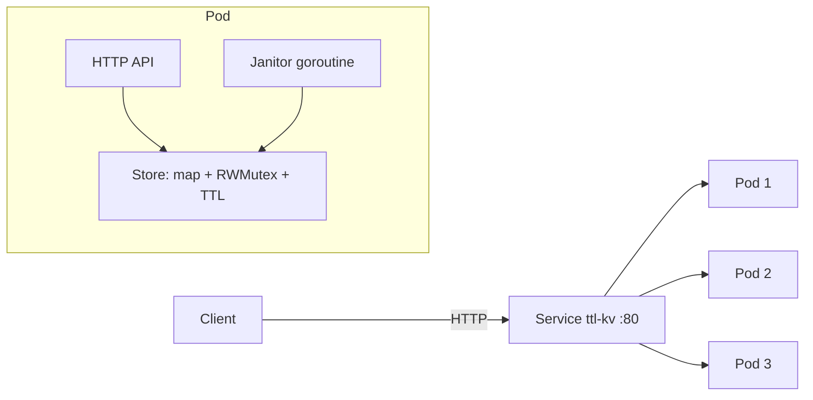

# ttl-kv-service

A small in-memory key-value store with per-key TTL, written in Go, containerized with Docker and deployed to Kubernetes (3 replicas, probes, rolling updates, graceful shutdown).

I built it to practise the pieces a cloud backend service needs: a concurrency-safe core, an HTTP API, health and readiness signalling, a minimal container image and a Kubernetes deployment.

## Architecture



- `internal/store`: map guarded by `sync.RWMutex`; values copied on read and write; TTL checked lazily on read plus a background janitor sweep; injectable clock for deterministic tests.
- `internal/api`: routes using Go 1.22 `ServeMux` patterns; 1 MiB value limit; `/healthz` (liveness), `/readyz` (readiness), `/metrics` (expvar counters).
- `cmd/server`: timeouts on the HTTP server; on SIGTERM it flips readiness to failing, waits 3 s so the Service stops routing to the pod, then drains in-flight requests.

## API

| Method | Path | Behaviour |
| --- | --- | --- |
| PUT | `/v1/keys/{key}?ttl=SECONDS` | Store the request body. `ttl` optional; 0 or absent means no expiry. 204 on success. |
| GET | `/v1/keys/{key}` | 200 with the value, or 404 if missing or expired. |
| DELETE | `/v1/keys/{key}` | 204, or 404 if missing. |
| GET | `/healthz`, `/readyz`, `/metrics` | Liveness, readiness, counters. |

```bash
curl -X PUT 'localhost:8080/v1/keys/greeting?ttl=30' -d 'hello'
curl localhost:8080/v1/keys/greeting
```

## Run it

Requirements: Go 1.22+, Docker. For Kubernetes: [kind](https://kind.sigs.k8s.io/) and kubectl.

```bash
make test        # go vet + tests with the race detector
make run         # run locally on :8080

make kind-up     # local 3-node cluster
make deploy      # build image, load into kind, apply manifests
make forward     # then curl localhost:8080
make kind-down
```

Useful checks once deployed:

```bash
kubectl get pods -o wide
kubectl rollout restart deployment/ttl-kv   # rolling update, zero unavailable
kubectl logs deploy/ttl-kv
```

## Design decisions and known limits

- **Replicas do not share data.** Each pod has its own in-memory map, so a key written through the Service may be missing on the next request if it hits another pod. This is deliberate for a first version; it shows why stateful services need replication or sharding.
- **Lazy plus periodic expiry** keeps reads cheap and bounds memory without a timer per key.
- **Single global lock.** Simple and correct under the race detector; sharding the map would reduce contention under heavy writes.
- **No persistence.** A restart clears all data.

## Next steps

1. Consistent-hash routing so a key always lands on the same pod (StatefulSet plus headless Service).
2. Replication with a leader and followers, or a simple Raft implementation.
3. Sharded locks plus a benchmark comparing throughput.
4. Prometheus-format metrics and a Horizontal Pod Autoscaler.
